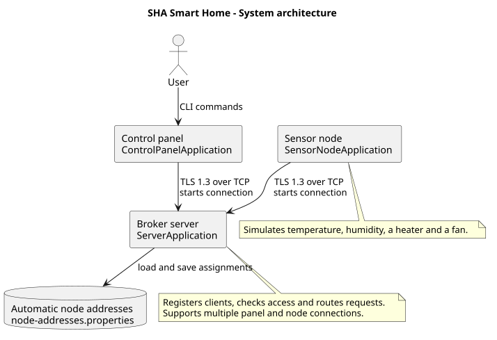
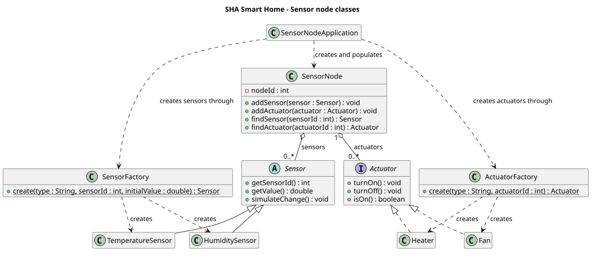
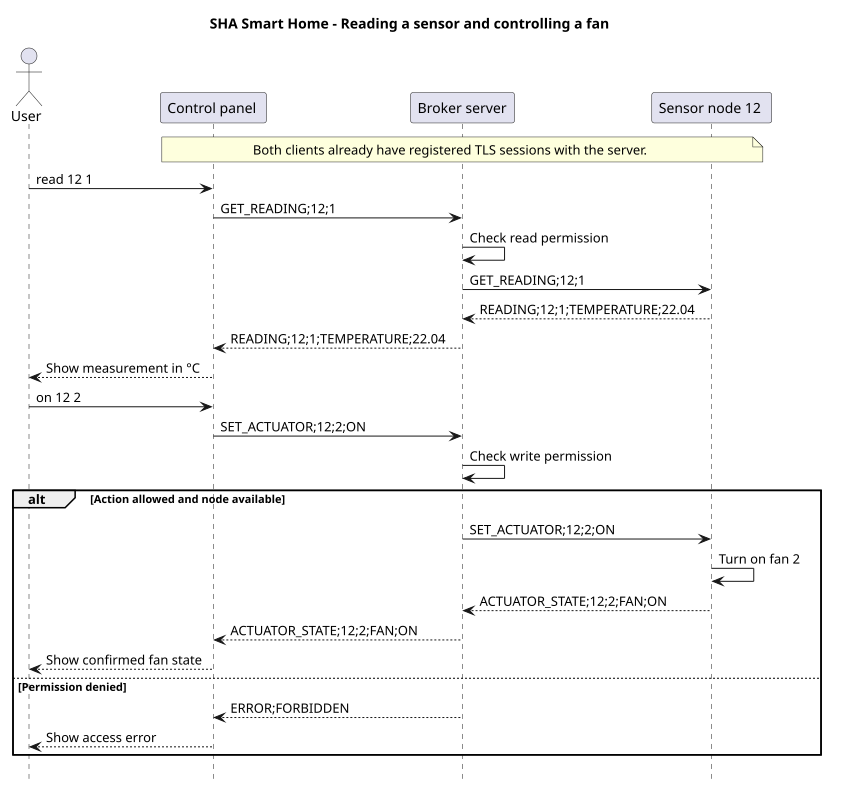
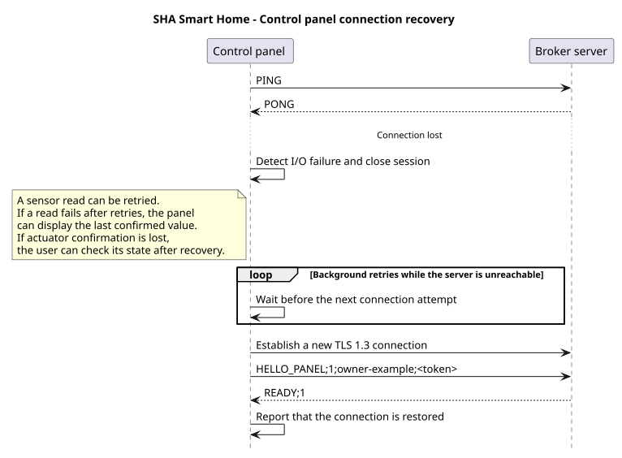
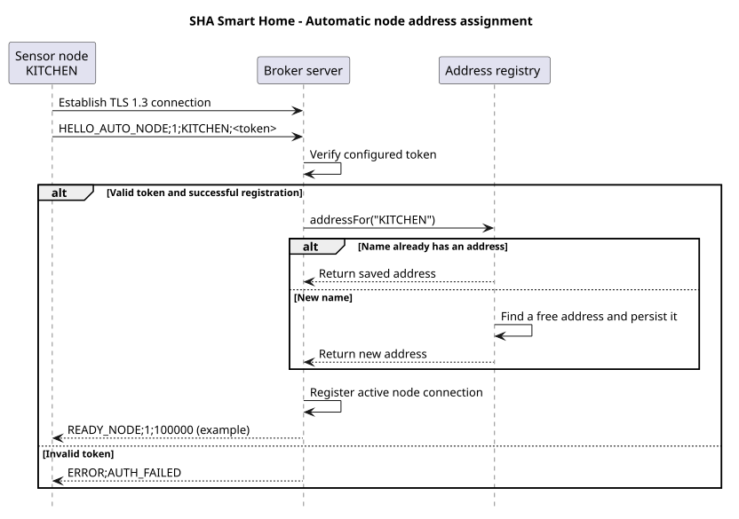

# SHA Smart Home

This is a smart-home simulation built for NTNU’s IDATA2304 Computer Communication and Network Programming course.
The project implements a custom application protocol over TCP with TLS 1.3.
A control panel discovers sensor nodes, reads temperature and humidity, checks heater and fan status, and sends commands through a server.

## Start

### macOS and Linux

Install JDK 25 and run this from the project root on macOS or Linux.

```sh
./run-local.sh
```

### Windows

Install JDK 25 and Git for Windows. From the project root, run this in PowerShell.

```powershell
& "C:\Program Files\Git\bin\bash.exe" ./run-local.sh
```

If Git for Windows is installed elsewhere, open Git Bash in the project root and run the launcher there.

```bash
bash ./run-local.sh
```

The launcher builds the project, creates temporary login tokens and a TLS certificate, and starts the server, two sensor nodes, and the control panel. The panel opens in the same terminal.

Nodes `12` and `13` both have temperature sensor `1`, humidity sensor `2`, heater `1`, and fan `2`. Node `13` also has humidity sensor `3` and fan `3`.

Try these commands in the control panel.

```text
list
read 13 3
on 13 3
status 13 3
off 13 3
exit
```

### Manual setup

Use this setup for IntelliJ, separate terminals, or separate machines. Use JDK 25 and run each application with the project root as its working directory.

1. Copy `config/local.properties.example` to `config/local.properties` and replace the placeholder tokens with your own values.
2. Follow the [TLS setup guide](docs/running.md#set-up-tls) to create the server keystore, set its password, and configure the public certificate for clients.
3. Start the server, sensor nodes, and control panel in that order. The [running guide](docs/running.md#start-the-applications) lists the Java main classes.

When all apps run from the same project folder, they share `config/local.properties`. The file is ignored by Git, and environment variables override its values.

The default address is `127.0.0.1:5000`. For separate machines, set `SMART_HOME_HOST` and `SMART_HOME_PORT` so the clients can reach the server. The client’s configured hostname or IP address must match the TLS certificate.

## How it works

The server authenticates clients, applies role permissions, and routes requests.
Sensor nodes simulate readings and actuator state.
The control panel discovers nodes, displays readings and anomaly warnings, and sends commands to specific devices.



<details open>
<summary>Sensor node classes</summary>

[](docs/diagrams/rendered/02-sensor-node-classes.svg)

</details>

<details open>
<summary>Reading a sensor and controlling a fan</summary>



</details>

The [protocol specification](docs/protocol.md) describes the message formats, registration, permissions, and error handling. The [diagram index](docs/diagrams/index.md) links to the PlantUML sources.

## Networking extras

### Outage recovery

Nodes and panels reconnect automatically.
The panel retries interrupted reads and can show a timestamped cached reading during a longer outage.

<details open>
<summary>Control panel connection recovery</summary>



</details>

### Encrypted transport

Both client connections use TLS 1.3.
Clients verify the server’s certificate and address before sending login tokens.

### Automatic node addresses

The server assigns unique numeric addresses to provisioned nodes and saves the assignments across reconnects and server restarts.

<details open>
<summary>Automatic node registration</summary>



</details>

## How to run tests

With JDK 25 and Maven installed, run the tests from the project root. The TLS integration tests use localhost sockets.

```sh
mvn test
```
# AI Declaration

The protocol.md document has been translated from Norwegian to English with the use of AI, and it also assisted
in the writing of both this document, as well as the code generation in general. You will find notes in the respective
classes where the AI has been used to partly generate code. The diagrams were also made with the assistance of AI.
All changes made by AI has been reviewed by the team members.
